<div align="center">



<br>


<br><br>

[Видео](#видео) · [Как работает](#как-работает) · [Установка](#установка) · [Вместо Handy](#вместо-handy) · [Справочник](#справочник)

</div>

<br>

## Видео

<a href="docs/readme/intro.mp4"></a>

> *Verba volant, scripta manent* — слова улетают, написанное остаётся.

<br>

## Как работает



Поле запоминается при нажатии: ушёл в другое окно, пока говорил, — текст всё равно встанет туда. Прежний буфер обмена возвращается. Запись хранится, пока не распознана: <kbd>Ctrl</kbd>+<kbd>Alt</kbd>+<kbd>V</kbd> отправит её снова.

<br>

## Если сеть зависла



<br>

## Память



<br>

## Хоткеи



Диктовка — держать, нажал-включил или гибрид: короткое нажатие фиксирует запись, долгое — держать.

<br>

## Установка

Нужны Windows 10 или 11 x64 и Rust stable.

```powershell
git clone https://github.com/Laimusp/verba.git
cd verba
cargo build --release
.\target\release\verba.exe           # окно настроек: ключ OpenRouter, модель, хоткеи; значок в трее
```

> [!TIP]
> Без ключа OpenRouter — по подписке ChatGPT: `codex login` в Codex CLI, затем в окне Verba «Распознавание» → ChatGPT.

<br>

## Вместо Handy

Verba и Handy ловят один и тот же <kbd>Ctrl</kbd>+<kbd>Space</kbd> — Handy убирается и из автозапуска.

1. Handy → «Настройки» → «Продвинутые» → выключить «Запускать при старте».
2. Выключить его задачу планировщика — в PowerShell от имени администратора:
   ```powershell
   schtasks /change /tn "Handy (admin)" /disable
   ```
3. Закрыть Handy: значок в трее → «Выход».
4. Запустить Verba: откроется окно настроек → «Общее» → включить «Запускать с Windows» → «Да» в окне UAC.

С правами Verba диктует и в окна, запущенные от администратора, — в игры тоже: процессу без прав Windows их клавиши не отдаёт. После входа в Windows Verba стартует сама, сразу в трей.

> [!TIP]
> Настройки — в окне Verba: открывается при запуске и из трея. Команды из справочника — для отладки и скриптов.

<details>
<summary><b>Вернуть Handy</b></summary>

<br>

1. Verba → окно настроек → «Общее» → выключить «Запускать с Windows» («Да» в окне UAC) → «Выйти».
2. В PowerShell от имени администратора: `schtasks /change /tn "Handy (admin)" /enable`
3. Handy → «Продвинутые» → включить «Запускать при старте» и запустить Handy.

</details>

<br>

## Справочник

<details>
<summary><b>Движок</b></summary>

<br>

- **OpenRouter** — по ключу; модель — в окне Verba (список OpenRouter или по имени) или в трее «Движок и модель», по умолчанию `openai/gpt-transcribe`.
- **ChatGPT по входу Codex** — по подписке. Verba читает `%USERPROFILE%\.codex\auth.json` (или `%CODEX_HOME%`) и никогда его не пишет: истекающий вход обновляет сам Codex через `codex app-server`. Codex не на PATH — путь в `codex.program`. Адрес распознавания у ChatGPT непубличный: может перестать работать с обновлением Codex.
- Смена движка действует со следующей диктовки. «Проверить» в окне Verba или `verba codex check [запись.wav]` проходит весь путь и показывает задержку.

</details>

<details>
<summary><b>Файлы и секреты</b></summary>

<br>

- Настройки — окно Verba (щелчок по значку в трее); всё сохраняется в `%APPDATA%\Verba\config.json` и действует сразу. Правки файла руками тоже подхватываются на лету.
- Лог — `%LOCALAPPDATA%\Verba\logs\verba.log`: фазы каждой диктовки, без текста и ключей.
- Ключ OpenRouter и пароль прокси — Windows Credential Manager (`Verba/OpenRouter`, `Verba/Proxy`), не в JSON.
- Прокси — HTTP, HTTPS, SOCKS4 или SOCKS5 в любой записи: окно Verba → «Распознавание» → «Прокси» (вид определится сам, видна задержка) или `verba proxy set "<строка>"`.
- Вставка в запомненное поле — `paste.remember_field` (включена); в играх из `paste.games` текст встаёт, только если фокус на месте. Как это устроено — `docs/focus-restore.md`.

</details>

<details>
<summary><b>Команды</b></summary>

<br>

Обычно не нужны: всё настраивается в окне Verba. Команды — для отладки и скриптов.

| Команда | Что делает |
| :- | :- |
| `verba` | запустить: окно настроек и значок в трее; второй запуск показывает окно первого |
| `verba --tray` | запустить в трей без окна — так стартует автозапуск |
| `verba key set [КЛЮЧ]` | сохранить ключ OpenRouter; без аргумента — из буфера обмена |
| `verba key check` · `verba key clear` | проверить ключ · удалить |
| `verba proxy set [СТРОКА]` · `verba proxy clear` | сохранить прокси (без аргумента — из буфера обмена) · убрать |
| `verba codex check [ФАЙЛ.wav]` | проверить «ChatGPT по входу Codex»; с файлом — распознать его и показать задержку |

</details>

<details>
<summary><b>Разработка</b></summary>

<br>

```powershell
cargo clippy --all-targets -- -D warnings
cargo test                                    # сеть — на локальном фейковом сервере, не на живых сервисах
```

Обходы ограничений Windows (хук, вставка, буфер обмена, оверлей, автозапуск) — `docs/windows.md`.

**Окно настроек** — [Slint](https://slint.dev) (`ui/settings.slint`, лицензия Slint Royalty-free 2.0), стиль fluent, программная отрисовка: окно создаётся по требованию и освобождается при закрытии. Замер открытия и памяти — `cargo run --release --example slint_probe`.

**Знак** — три полосы голоса уходят в текстовый курсор. Он рисуется кодом в `src/icons.rs`: значок трея и иконка `assets/verba.ico`, которую `build.rs` вшивает в exe. Пересобрать иконку после правки знака:

```powershell
$env:VERBA_WRITE_ICON = 1; cargo test --test app_icon; Remove-Item env:VERBA_WRITE_ICON
```

**Картинки README** — Python с fontTools, Chrome и ffmpeg:

```powershell
python docs/readme/src/build-svg.py   # шапка, схемы, хоткеи, знак: текст — контурами Segoe UI Variable
node docs/readme/src/render.mjs       # видео: сцена intro.html кадр за кадром → MP4 и AVIF
```

</details>

<br>

Лицензия — MIT, файл `LICENSE`.

<p align="center">
  
  <br>
  <sub>verba volant, scripta manent</sub>
</p>
